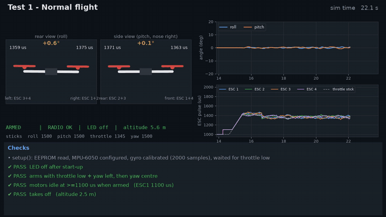
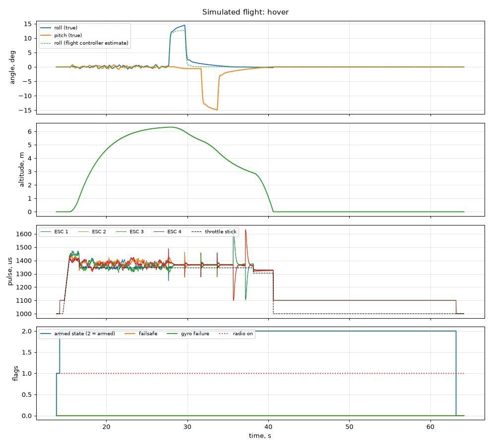
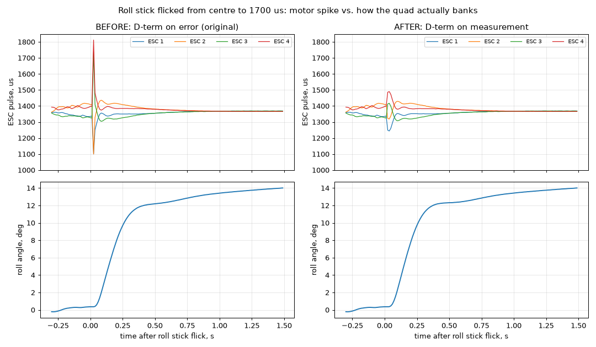

# Arduino-Based F450 Quadcopter Drone

A complete flight controller for an **F450 quadcopter** running on an **Arduino Uno / Nano** with an **MPU-6050** gyro/accelerometer. It self-levels, flies from a normal RC transmitter, and has a radio-loss failsafe, gyro-failure protection and low-battery warning. It also comes with a **PC flight simulator** that runs the real Arduino code against a physics model of the drone, so every feature can be tested before the drone leaves the ground.

Based on **YMFC-AL** by Joop Brokking ([brokking.net](http://www.brokking.net)), with bug fixes and added safety features (see [What's improved](#whats-improved)).

<p align="center">
  <a href="docs/media/flight_tests.mp4">
    
  </a>
  <br>
  <em>The real <code>flight_controller.ino</code> flying a simulated F450. <a href="docs/media/flight_tests.mp4"><b>▶ Watch the full 2-minute test video</b></a></em>
</p>

> ⚠️ **Safety:** Always remove the propellers for setup, calibration and bench tests. Fly only in an open area away from people. This is hobby software and comes with no guarantee.

---

## Contents

- [How it works](#how-it-works)
- [Hardware](#hardware)
- [Wiring](#wiring)
- [The three sketches](#the-three-sketches)
- [Quick start](#quick-start)
- [Flying](#flying)
- [Flight simulator and test results](#flight-simulator-and-test-results)
- [What's improved](#whats-improved)
- [Project structure](#project-structure)
- [Limitations](#limitations)
- [Credits](#credits)

---

## How it works

Every 4 ms (250 times a second) the Arduino:

1. **Reads the sticks:** pin-change interrupts measure the receiver pulses (1000-2000 µs) for roll, pitch, throttle and yaw.
2. **Reads the MPU-6050:** rotation rates (gyro) and the direction of gravity (accelerometer) over I2C.
3. **Estimates the tilt:** a complementary filter combines the fast but drifting gyro with the slow but drift-free accelerometer.
4. **Runs three PID controllers** (roll, pitch, yaw). With auto-level on, centred sticks mean "fly level".
5. **Mixes the corrections onto the four motors**, adds battery-voltage compensation, and sends a 1000-2000 µs pulse to each ESC.

```
Receiver ──► stick values ──┐
                            ├──► PID (roll / pitch / yaw) ──► motor mixing ──► ESC 1-4 ──► motors
MPU-6050 ──► angle estimate ┘
```

## Hardware

| Part | Notes |
|---|---|
| Flight controller | Arduino **Uno or Nano (ATmega328P, 16 MHz)**. Mega / ESP32 / Nano Every won't work (the code uses the chip's registers directly). |
| IMU | **MPU-6050** (GY-521 board) |
| Frame | F450 (450 mm, X configuration) |
| Motors / props | 4× 2212 ~920 KV, 10×4.5 props (2 CW + 2 CCW) |
| ESCs | 4× 20-30 A PWM ESCs (SimonK / BLHeli), 250 Hz capable |
| Battery | 3S LiPo (11.1 V), 2200-3300 mAh |
| Radio | Transmitter + PWM receiver, 4+ channels |
| Extras | LED + 330 Ω resistor, 1N4001 diode, 1.5 kΩ + 1 kΩ resistors (battery monitor) |

## Wiring

| Arduino pin | Connects to |
|---|---|
| D8, D9, D10, D11 | Receiver channels (any order, setup detects them) |
| D4 | ESC 1, front-right, **CCW** |
| D5 | ESC 2, rear-right, **CW** |
| D6 | ESC 3, rear-left, **CCW** |
| D7 | ESC 4, front-left, **CW** |
| A4 / A5 | MPU-6050 SDA / SCL |
| D12 | Status LED (through a 330 Ω resistor) |
| A0 | Battery: + → diode → 1.5 kΩ → **A0** → 1 kΩ → GND |

```
        FRONT
   ESC 4      ESC 1
    (CW)      (CCW)
       \      /
        \    /
         [FC]
        /    \
       /      \
   ESC 3      ESC 2
   (CCW)      (CW)
        REAR
```

## The three sketches

Upload them **in this order**:

| # | Sketch | Purpose |
|---|---|---|
| 1 | [`ymfc_setup`](ymfc_setup/ymfc_setup.ino) | Interactive setup in the Serial Monitor (57600 baud). Learns your transmitter channels, endpoints and reversing, finds the MPU-6050 and how it's mounted, and saves everything to EEPROM. |
| 2 | [`esc_calibration`](esc_calibration/esc_calibration.ino) | Calibrates the ESCs, then lets you test from the Serial Monitor: `r` = stick values, `a` = angles, `1`-`4` = spin one motor, `5` = all motors (with a vibration readout for prop balancing). |
| 3 | [`flight_controller`](flight_controller/flight_controller.ino) | The flight software. |

## Quick start

**Requirements:** Arduino IDE (or `arduino-cli`) with **Arduino AVR Boards 1.8.3 or newer**, which is needed for the I2C timeout protection.

1. Wire everything as above. **Props off.**
2. Upload `ymfc_setup` and follow the prompts until it prints `Setup is finished.`
3. Upload `esc_calibration`. With the throttle at full, plug in the battery. When the ESCs beep, pull the throttle down. Check the sticks (`r`), the angles (`a`) and each motor's spin direction (`1`-`4`).
4. Set the accelerometer level offsets and the failsafe options at the top of `flight_controller.ino`, then upload it.

📘 **For the full step-by-step guide, with what you should see at every step and how to fix errors, see [FIRST_FLIGHT_GUIDE.md](FIRST_FLIGHT_GUIDE.md).**

Compile from the command line:

```bash
arduino-cli compile --fqbn arduino:avr:uno flight_controller
```

## Flying

| Action | Sticks |
|---|---|
| **Arm** | Throttle down + yaw left, then yaw back to centre |
| **Disarm** | Throttle down + yaw right |

| LED (D12) | Meaning |
|---|---|
| Blinking fast at start-up | Gyro calibration, keep still |
| Off | Ready |
| Slow blink (2 Hz) | Battery low (below 10.5 V), land |
| Solid on in flight | Loop overrun or **gyro failure**. Motors are stopped; power-cycle. |
| Very fast blink forever | Wrong gyro type stored. Re-run setup. |

**Failsafe:** if the radio signal is lost for 100 ms, the drone levels out and then either stops the motors (default, `failsafe_throttle = 1000`) or descends slowly for 5 s and then stops (set `failsafe_throttle` a little below your hover throttle). Set your receiver's own failsafe to **"no pulses"** so the loss can be detected.

## Flight simulator and test results

The [`sim/`](sim) folder compiles the **unmodified** `flight_controller.ino` on a PC and connects it to a simulated F450:
- motors with spin-up lag, the frame's inertia, gravity and drag;
- an MPU-6050 with gyro bias, prop vibration and its built-in 43 Hz filter;
- wind gusts and a 50 Hz PWM receiver.

The fake Arduino layer copies the Uno exactly: 16-bit `int`, 32-bit `double`, and the `micros()` timer rolling over.

```bash
pip install ziglang matplotlib
python sim/run_sim.py        # 6 flight tests + plots
python sim/robustness.py     # same code on 23 different F450 builds
python sim/make_video.py     # renders the test video (needs ffmpeg)
```

### Flight tests: 42/42 checks passed

| Test | Result |
|---|---|
| Normal flight | Takes off, hovers in gusts with **0.44° RMS** tilt, sticks bank the right way (~14°), lands and disarms |
| Radio signal lost | Motors stop **88 ms** after the last pulse; no re-arming without a signal |
| Signal lost, descent mode | Levels out, descends from 12.5 m to 2.6 m, stops after 5 s |
| MPU-6050 wire comes loose | Motors stop in **104 ms** instead of freezing; LED on; won't re-arm |
| Armed on a 6° slope | No I-term build-up, clean take-off and level-out |
| Noisy receiver | 300 µs noise spikes ignored; one dropped frame doesn't trigger the failsafe |

<p align="center"></p>

### Robustness: 23/23 F450 builds passed

The default PID gains stayed stable on every build tested: 0.9-1.9 kg, 6-11 N motors, 20-100 ms motor lag, unbalanced props (up to 4× vibration), 3× wind gusts, and 11.0-12.4 V batteries.

Pushed to the limit, the defaults handle about **4× normal motor lag, 8× normal vibration and 5× normal wind**. They are tuned for F450-sized frames and are too aggressive for small (250-size) quads.

### Smoother stick response

The D-term now reacts only to the drone's actual rotation, not to stick movement. A sharp stick flick used to slam the ESCs by up to **416 µs**; now it's **95 µs**, with the same response speed.

<p align="center"></p>

> A simulator shows that the logic, directions and safety features are correct. It can't tune your specific drone. Follow the [first-flight guide](FIRST_FLIGHT_GUIDE.md) on the real hardware.

## What's improved

Compared with the original YMFC-AL code:

**Flight controller**
- ✅ **Radio failsafe:** detects signal loss (100 ms), levels out, then stops the motors or does a timed descent
- ✅ **Gyro-failure protection:** I2C timeout plus a read check, so a loose MPU-6050 stops the motors instead of freezing the loop
- ✅ Halts if setup stored an unsupported gyro (the original flew on with no gyro data)
- ✅ **No I-term windup** while armed on the ground, which prevents flips on take-off
- ✅ **D-term on measurement:** no motor spike on sharp stick moves
- ✅ Separate LED signals for low battery (blinking) and loop overrun / gyro failure (solid)
- ✅ Safe receiver reads (`volatile`, atomic, 800-2200 µs pulse filter) and no divide-by-zero on bad setup data
- ✅ ESC pulse timing survives the `micros()` overflow; accelerometer level offsets are now settings

**Setup program**
- ✅ Needs **all four** receiver channels to be valid (the original passed with one)
- ✅ Fixed a dangling `else` in the gyro-axis detection
- ✅ I2C timeout (ERROR 9) and an MPU-6050-only check (ERROR 10)

**ESC calibration:** the same receiver, I2C, overflow and safety fixes.

**Project:** the code was converted from a single Word document (`docs/original_code.docx`) into three Arduino sketches that compile.

## Project structure

```
├── ymfc_setup/              1. Setup program (transmitter + gyro calibration → EEPROM)
├── esc_calibration/         2. ESC calibration and motor / sensor tests
├── flight_controller/       3. Flight software
├── sim/                     PC flight simulator, robustness sweep, video renderer
├── docs/
│   ├── media/               Test video, GIF preview and charts
│   └── original_code.docx   The original code document
├── FIRST_FLIGHT_GUIDE.md    Step-by-step build and first-flight guide
└── README.md
```

## Limitations

- 250 Hz loop with bit-banged PWM. No OneShot / DShot, so it's less locked-in than a Betaflight or ArduPilot board.
- No altitude hold, GPS, telemetry or logging.
- The battery monitor assumes a 3S pack and the divider described above.
- PID gains are tuned for F450-sized frames.

## Credits

- Original flight controller design and code: **Joop Brokking**, YMFC-AL ([brokking.net](http://www.brokking.net)). The original "AS IS" terms of use are kept in each sketch.
- Fixes, safety features, flight simulator and documentation: this repository.
